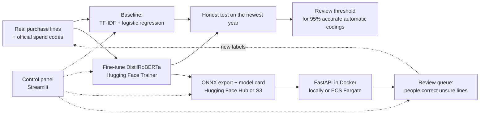

# 🧾 SpendCoder

**A fine-tuned transformer that codes purchase and invoice lines into spend categories, and sends the unsure ones
to a person.**

[](https://colab.research.google.com/github/saeedm31/SpendCoder/blob/main/notebooks/SpendCoder_finetuning.ipynb)
[](https://github.com/saeedm31/SpendCoder/actions/workflows/tests.yml)
[](https://huggingface.co/docs/transformers)
[](LICENSE)

📚 [How fine-tuning works](docs/how-fine-tuning-works.md) · [Architecture](docs/architecture.md) · [AWS option](docs/aws.md) · [Data card](docs/data_card.md) · [Notebook](notebooks/SpendCoder_finetuning.ipynb)

---

## 💡 The problem

A company's accounts payable and procurement teams receive thousands of lines like *"ANNUAL MAINTENANCE OF
PRODUCTION LINE PUMPS"* or *"DELL LATITUDE LAPTOPS"*. Each needs the right spend category (or GL account) before
it is posted and analysed. Doing it by hand is slow and inconsistent; keyword rules break on new wording.

SpendCoder reads the line, suggests one of **14 spend categories**, says **how sure** it is, and codes it
automatically only when it is confident enough. Everything else goes to a person with the top 3 suggestions.

## 🧠 How it works



1. **Real data:** about 60,000 US Department of Energy contract descriptions with their official Product and
   Service Codes ([USAspending.gov](https://www.usaspending.gov), public domain), grouped into 14 categories.
2. **Time split, like production:** train on contracts before October 2023, validate on the next year, test on the
   newest (from October 2024). Test lines whose exact text is in training are removed.
3. **Baseline first:** TF-IDF + logistic regression. The transformer has to beat it.
4. **Fine-tuning:** pretrained DistilRoBERTa plus a new classification head, trained with the Hugging Face
   `Trainer` (learning rate 5e-5, up to 4 epochs, warmup, fp16, best epoch by validation macro F1, early stopping).
5. **Evaluation:** accuracy, macro F1, per-category scores and error analysis on the test year.
6. **Business rule:** a confidence threshold chosen on validation; above it the line is coded automatically, below
   it a person decides.
7. **Production:** ONNX export (checked against PyTorch), model card and versioned model on the Hugging Face Hub,
   FastAPI service in Docker without PyTorch.
8. **Control panel (Streamlit):** load data, train the baseline, launch fine-tuning (Colab, AWS SageMaker or
   locally), evaluate and pick the review threshold, classify lines, correct unsure ones in a review queue, and
   promote a model to production. Actions that cost money or change production need an admin password.
9. **AWS option:** SageMaker training job (GPU, spot), S3 as data and model store with versions, the API on ECS
   Fargate behind a load balancer, all in Terraform with least-privilege roles. See [docs/aws.md](docs/aws.md).

New to fine-tuning? Read [how fine-tuning works](docs/how-fine-tuning-works.md): what it is, each step, when to
use it instead of an LLM prompt or RAG, and how companies run it in production.

## 📈 Results

Results are written to `reports/finetuned.json` and the model card when you run the notebook.

| Model (test year) | Accuracy | Macro F1 |
|---|---|---|
| TF-IDF + logistic regression | to be filled by the notebook run | |
| Fine-tuned DistilRoBERTa | to be filled by the notebook run | |

## 🚀 Run it

**Fine-tune (recommended: Google Colab, free T4 GPU, about 30 minutes):** click *Open in Colab* above and run the
cells top to bottom.

**Or locally:**

```bash
pip install -r requirements-train.txt
python scripts/prepare_data.py                     # download and label the data (about 10 minutes)
python scripts/train.py --baseline-only            # baseline in seconds
python scripts/train.py --push <hf-user>/spendcoder-distilroberta   # fine-tune, export ONNX, publish
```

**Or on AWS SageMaker** (after `terraform apply` in `infra/terraform`, see [docs/aws.md](docs/aws.md)):

```bash
python scripts/aws_train.py --promote --restart    # train on a GPU, promote the model, roll the ECS API
```

**Control panel:** `streamlit run streamlit_app.py` (set `ADMIN_PASSWORD` and, optionally, the AWS settings in
Streamlit secrets).

**Serve the model (CPU, no PyTorch):**

```bash
pip install -r requirements.txt
MODEL_REPO=<hf-user>/spendcoder-distilroberta uvicorn serve.app:app --port 8000
curl -X POST localhost:8000/classify -H "Content-Type: application/json" \
     -d '{"lines": ["Annual maintenance of production line pumps", "Dell Latitude laptops"]}'

docker build -t spendcoder . && docker run -e MODEL_REPO=<hf-user>/spendcoder-distilroberta -p 8000:8000 spendcoder
```

| Endpoint | Returns |
|---|---|
| `POST /classify` | For each line: category, confidence, `needs_review`, top 3 suggestions; plus how many need review |
| `GET /health` | Model status and the review threshold |

## 📁 Project structure

```
├── notebooks/SpendCoder_finetuning.ipynb   # the hands-on walkthrough (Colab)
├── spendcoder/
│   ├── taxonomy.py      # Product and Service Codes -> 14 spend categories
│   ├── data.py          # download, clean, label, time split
│   ├── baseline.py      # TF-IDF + logistic regression
│   ├── finetune.py      # Hugging Face Trainer fine-tuning
│   ├── metrics.py       # accuracy, macro F1, automation at a threshold
│   ├── export.py        # ONNX export and parity check
│   ├── predictor.py     # ONNX inference + review decision
│   ├── aws.py           # SageMaker training, S3 model store, promote, ECS restart
│   └── modelcard.py     # model card for the Hub
├── scripts/             # prepare_data.py, train.py, aws_train.py
├── serve/app.py         # FastAPI service (model from a folder, the Hub or S3)
├── streamlit_app.py     # control panel
├── infra/terraform/     # AWS: S3, SageMaker role, ECR, ECS Fargate, load balancer
├── Dockerfile
├── docs/                # how fine-tuning works, architecture, AWS option, data card
└── tests/               # no network, no GPU
```

## ✅ Tests

`python -m unittest` runs on every push. The data API, tokenizer and ONNX session are replaced by fakes, so tests
need no network, GPU or PyTorch. They cover the category mapping, text cleaning, pagination and rate-limit retry,
de-duplication and the time split without text leakage, the baseline, the metrics and threshold choice, the
review decision, the API (including input limits), the model card, the AWS functions (with fake AWS clients)
and that every page of the control panel renders.

## ⚠️ Limitations

- Trained on one public-sector buyer's wording. Another company's lines (supplier names, other languages,
  internal codes) differ: test on its own labelled lines and fine-tune further.
- Spend codes are chosen by buyers and are sometimes debatable, so part of the measured error is label noise.
- English only. For other languages, start from a multilingual model (for example `xlm-roberta-base`).

## 📚 Data

US Department of Energy contract descriptions and Product and Service Codes from USAspending.gov (US government
data, public domain). Base model: [distilroberta-base](https://huggingface.co/distilroberta-base) (Apache 2.0).

---

Built by [Saeed Hojjatpanah](https://github.com/saeedm31).
