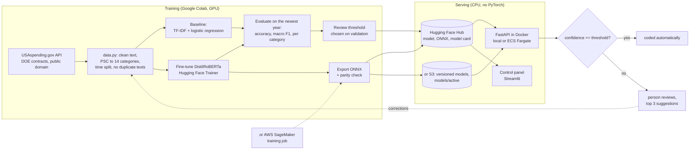

# Architecture

## The parts

| Part | Code | What it does |
|---|---|---|
| Taxonomy | `spendcoder/taxonomy.py` | groups thousands of Product and Service Codes into 14 spend categories |
| Data | `spendcoder/data.py`, `scripts/prepare_data.py` | downloads contracts, cleans text, labels, time split, removes test texts seen in training |
| Baseline | `spendcoder/baseline.py` | TF-IDF (words and characters) + logistic regression |
| Fine-tuning | `spendcoder/finetune.py`, `notebooks/SpendCoder_finetuning.ipynb` | Hugging Face Trainer on DistilRoBERTa, best epoch by validation macro F1, early stopping |
| Metrics | `spendcoder/metrics.py` | accuracy, macro F1, per category; automation share and accuracy at a threshold |
| Export | `spendcoder/export.py` | ONNX export, parity check against PyTorch, metadata (labels, threshold) |
| Inference | `spendcoder/predictor.py` | ONNX + tokenizers; decision rule with review flag and top 3 suggestions |
| API | `serve/app.py`, `Dockerfile` | FastAPI, input limits, model from a folder, the Hub or S3 |
| Control panel | `streamlit_app.py` | data, baseline, launch fine-tuning, evaluate and set the threshold, classify, review queue, promote and restart; admin password for costly actions |
| AWS | `spendcoder/aws.py`, `scripts/aws_train.py`, `infra/terraform` | SageMaker training, S3 model store, promote to production, ECS Fargate API; see [AWS option](aws.md) |
| Model card | `spendcoder/modelcard.py` | results, data, intended use and limits, written to the Hub |

## Design choices

- **Small encoder model, not an LLM:** a fixed classification task at high volume: fast, cheap, private,
  consistent. See [how fine-tuning works](how-fine-tuning-works.md) for the comparison.
- **Time-based split:** train on the past, test on the future, like production.
- **Threshold chosen on validation, checked on test:** automatic codings reach a target accuracy; the rest go to
  a person.
- **ONNX for serving:** the API image needs no PyTorch; the parity check makes sure answers match.
- **Tests without network or GPU:** the API source, tokenizer and ONNX session are replaced by fakes, so CI is fast.

More: [data card](data_card.md) · [how fine-tuning works](how-fine-tuning-works.md) · [AWS option](aws.md)
