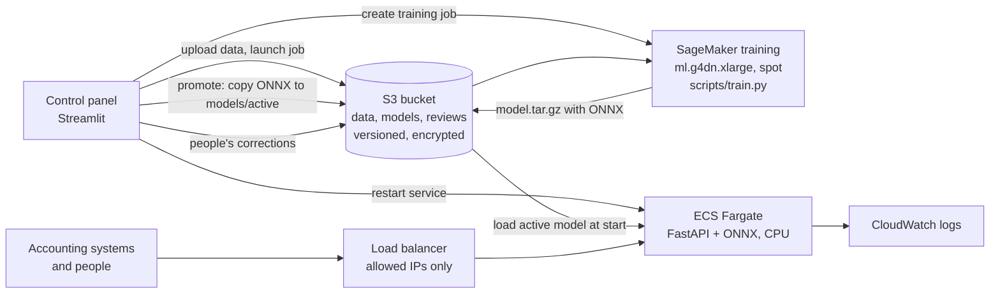

# Running SpendCoder on AWS (optional)

Colab is the quickest way to learn and to fine-tune once. A company would run the same steps on its cloud, with
access control, versioned models and a monitored API. This is the AWS version.



## What runs where

| Step | Service | Why |
|---|---|---|
| Data, models, corrections | **S3**, versioned and encrypted, public access blocked | every promoted model version is kept and can be rolled back |
| Fine-tuning | **SageMaker training job** on `ml.g4dn.xlarge` (one T4 GPU), spot capacity | pay only for the minutes of training; the same `scripts/train.py` as locally |
| Model registry | `s3://<bucket>/models/jobs/` (every run) and `models/active/` (production), with `active.json` saying which job is live and its scores | simple, auditable; SageMaker Model Registry is the next step for larger teams |
| API | **ECS Fargate** running the Docker image (ONNX on CPU, no PyTorch) behind an **Application Load Balancer** | no servers to manage, 0.5 vCPU / 1 GB is enough |
| Logs | **CloudWatch** | API and training logs in one place |
| Images | **ECR** with scan on push | |
| Control | **Streamlit control panel** or `scripts/aws_train.py` | launch, watch, promote, restart; actions need the admin password |

## Security choices

- The API only accepts traffic from `allowed_cidrs` (no default: you must say who may call it).
- Least privilege: the API task can only **read** `models/active/*`; the SageMaker role can only use the project
  bucket; the operator policy allows exactly launching jobs, passing that one role, the bucket, and restarting
  that one service.
- No access keys in Terraform or in the repo. Attach the operator policy to your IAM user or role; for the control
  panel, put credentials in Streamlit secrets.
- For real use: HTTPS (ACM certificate on the load balancer), a private VPC with NAT, and authentication in front
  of the API (for example API Gateway with IAM or Cognito).

## Set up

```bash
# 1. Infrastructure (about 3 minutes)
cd infra/terraform
terraform init
terraform apply -var='allowed_cidrs=["<your-ip>/32"]'
terraform output            # bucket, sagemaker_role_arn, ecr_repository_url, api_url, ecs_cluster, ecs_service

# 2. Build and push the API image
aws ecr get-login-password | docker login --username AWS --password-stdin <ecr_repository_url>
docker build -t <ecr_repository_url>:latest . && docker push <ecr_repository_url>:latest

# 3. Data and training on SageMaker, then promote the model
python scripts/prepare_data.py
export AWS_REGION=eu-west-1 SPENDCODER_BUCKET=<bucket> SAGEMAKER_ROLE_ARN=<sagemaker_role_arn>
python scripts/aws_train.py --promote

# 4. Start the API (it starts with 0 tasks, because it needs a promoted model to load)
terraform -chdir=infra/terraform apply -var='allowed_cidrs=["<your-ip>/32"]' -var='desired_count=1'
# later models: python scripts/aws_train.py --promote --restart   (with ECS_CLUSTER and ECS_SERVICE set)

# 5. Call it
curl -X POST <api_url>/classify -H "Content-Type: application/json" -d '{"lines": ["Dell Latitude laptops"]}'
```

Or do the training, promotion and restarts from the control panel: set these Streamlit secrets and use
pages 2 and 6.

```toml
# .streamlit/secrets.toml (never commit it)
ADMIN_PASSWORD = "..."
AWS_REGION = "eu-west-1"
AWS_ACCESS_KEY_ID = "..."        # an IAM user with the spendcoder-operator policy
AWS_SECRET_ACCESS_KEY = "..."
SPENDCODER_BUCKET = "..."
SAGEMAKER_ROLE_ARN = "..."
ECS_CLUSTER = "spendcoder"
ECS_SERVICE = "spendcoder-api"
API_URL = "http://..."
```

The training image is an AWS Deep Learning Container for Hugging Face. If the default tag in
`spendcoder/aws.py` is no longer listed in AWS's "Available Deep Learning Containers Images", set
`SAGEMAKER_IMAGE_URI` to a current Hugging Face PyTorch **training** GPU image for your region.

## Cost (rough, eu-west-1)

| Item | Cost |
|---|---|
| One fine-tuning run (about 15 minutes on `ml.g4dn.xlarge`, spot) | well under 1 USD |
| API: one Fargate task (0.5 vCPU, 1 GB) running all month | about 15 to 20 USD |
| Load balancer | about 18 to 20 USD a month |
| S3, ECR, CloudWatch | cents |

Set `desired_count=0` to stop the API, and `terraform destroy` to remove everything.

## Not tested yet

The Terraform and the SageMaker launch code are written and unit-tested with fake AWS clients, but have not yet
been applied to a real AWS account. Expect to adjust the training image tag and region on the first run.
